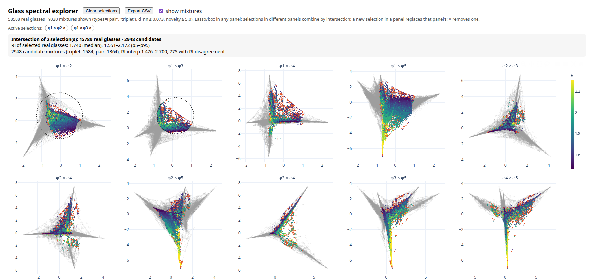

# glass_lagrangian

Spectral embedding (graph Laplacian eigenmaps) of ~58k oxide-glass compositions, colored by refractive index,
plus an interactive explorer for selecting regions of the map, including **empty** ones, and proposing new
glass compositions that would land there.



## Pipeline

| Step | Script | What it does | Time |
|---|---|---|---|
| 1 | `src/spectral_embedding.py` | Fits the spectral embedding on 10k landmark glasses and extends it to all glasses with Nyström. Writes 2D/3D plots, coordinates and the fitted model. | ~1 min |
| 2 | `src/validate_nystrom.py` | Checks how well Nyström places glasses that were not landmarks, and how stable the map is to the landmark draw. | ~3 min |
| 3 | `src/mixture_cloud.py` | Samples 300k convex mixtures of real glasses and embeds them, to find empty map regions reachable by known chemistry. | ~2 min |
| 4 | `src/train_ri_model.py` | Trains a refractive-index regressor (gradient boosting on composition) and reports 5-fold CV error. | ~30 s |
| 5 | `src/compare_ri_interpolation.py` | Compares the regressor with interpolating RI along the manifold (kNN graph). | ~2 min |
| 6 | `src/app.py` | Dash explorer: linked panels, region selection, candidate table and CSV export. | — |

## Setup

Requires [uv](https://docs.astral.sh/uv/). Always run from the repository root.

```bash
uv sync
```

### Data (not included)

The dataset is **not in this repository**. It merges SciGlass with INTERGLAD, a commercial database, and
patent data, so it is not redistributed here. Place it at `data/refractive_index.parquet` with:

- index `ID` (string);
- one column per oxide (`sio2`, `b2o3`, `na2o`, … 73 in total), as percentages that sum to 100 per row;
- `refractive_index` (float).

### Run

```bash
uv run src/spectral_embedding.py        # options: --m 10000 --sigma-scale 1.0 --n-components 10
uv run src/validate_nystrom.py --k 5
uv run src/mixture_cloud.py
uv run src/train_ri_model.py
uv run src/compare_ri_interpolation.py
uv run src/app.py                       # then open http://127.0.0.1:8050
```

Outputs go to `outputs/` (git-ignored):

```
outputs/
├── viz/      interactive plots (html)
├── data/     embeddings, mixture cloud, exported candidates (parquet, csv)
├── models/   fitted spectral model (npz), landmark indices, RI regressor (joblib)
└── logs/     run logs
```

## Method

### Spectral embedding

Classic Ng–Jordan–Weiss affinity on a random subsample of *m* = 10,000 landmark glasses. Compositions are
taken as fractions.

- Gaussian affinity: `A_ij = exp(−‖x_i − x_j‖² / 2σ²)`, with `A_ii = 0`.
  σ is the median pairwise distance (0.7255).
- Normalized Laplacian: `L = I − D^{-1/2} A D^{-1/2}`. We take its smallest eigenpairs.
- Coordinates: `φ_k = D^{-1/2} v_k` for the non-trivial eigenvectors. The trivial eigenvector is dropped.
  Rows are **not** normalized to unit length (as NJW clustering does), because that would put the 2D
  embedding on a circle.

**Why not a kNN graph with local bandwidths?** A first attempt used self-tuning σ_i, the distance to the
7th neighbor. In dense series of near-identical compositions σ_i → 0, edge weights underflowed
(min ≈ 1e-199) and the eigenvectors localized on clusters of 9–24 points.

### Nyström extension

Any composition `x`, not only landmarks, gets coordinates

```
φ_k(x) = (1/μ_k) · Σ_i p_i(x) · φ_k(x_i),    p_i(x) = K(x, x_i) / Σ_j K(x, x_j)
```

where `μ_k = 1 − λ_k`. This is `SpectralEmbedding.transform`, and it is what places proposed glasses on
the map.

Validation (`validate_nystrom.py --k 5`):

| | φ₁ | φ₂ | φ₃ | φ₄ | φ₅ |
|---|---|---|---|---|---|
| R², held-out glasses (Nyström) vs. exact fit including them | 0.9999 | 0.9999 | 1.000 | 0.9998 | 0.9998 |
| R², two disjoint landmark draws | 1.000 | 0.9998 | 0.9995 | 0.9998 | 0.995 |

The median relative error is about 1.2%, and it does not grow with distance to the nearest landmark.
φ₃ and φ₄ have close eigenvalues (0.953 and 0.961), so different fits may rotate them into each other.
Compare individual axes only within the same saved model.

### Mixture cloud: proposing compositions

The embedding has no inverse map. To get compositions that land in empty regions, we sample convex
mixtures of real glasses. A convex mixture of valid compositions is itself valid: non-negative and
summing to 100.

Three kinds of mixture are sampled:

- **pair:** a glass plus one of its 10 nearest neighbors in composition;
- **triplet:** a glass plus two of its neighbors;
- **random:** two arbitrary glasses.

Each mixture is embedded with Nyström and scored by:

- **`d_nn`:** distance to the nearest real glass in composition space, a plausibility check. For
  reference, the real-to-real nearest-neighbor distance has median 0.021 and p90 0.073.
- **novelty:** distance to the nearest real glass in standardized φ₁…φ₅, divided by the median
  real-to-real spacing. Real glasses themselves have p90 4.2 and p99 12.8.

Pair and triplet mixtures do reach the interior holes of the (φ₁, φ₂) map, with `d_nn` ≈ 0.03 (as close to
real glasses as real glasses are to each other). Random mixtures reach them too, but with `d_nn` ≈ 0.15,
which is extrapolation.

The kernel density `d(x)` is **not** a useful plausibility filter at this σ. Random mixtures, which lie
"in the middle" of composition space, score higher than real glasses.

### Refractive index of candidates

RI varies smoothly along the manifold. Interpolating it from composition neighbors is as accurate as a
trained regressor. 5-fold CV, RI restricted to [1.3, 3.0]:

| Method | MAE | Median AE | R² |
|---|---|---|---|
| Gradient boosting on composition | 0.0172 | 0.0082 | 0.961 |
| Harmonic extension on the kNN graph | 0.0163 | 0.0066 | 0.957 |
| Distance-weighted mean of 10 nearest glasses | 0.0160 | 0.0053 | 0.956 |
| Gradient boosting on φ₁…φ₁₀ | 0.0246 | 0.0119 | 0.937 |
| Linear on φ₁…φ₁₀ | 0.0638 | 0.0427 | 0.757 |

The explorer shows two RI estimates per candidate: `RI interp` (kNN interpolation) and `RI hgb`
(the regressor). Candidates where they differ by more than 0.03 are highlighted.

The random CV split is optimistic: the databases contain composition series of near-duplicates.

## Explorer (`src/app.py`)

- The 10 panels are all pairs of φ₁…φ₅, drawn as subplots of a single figure. Ten separate WebGL figures
  exceed the browser's WebGL context limit, and the oldest panels go blank.
- Points are real glasses (color = RI) drawn **over** orange mixtures. Orange is therefore visible only
  where no real glass is.
- Use lasso or box in any panel. Selections in different panels combine by **intersection**.
  - A new selection in a panel replaces that panel's previous one.
  - The **×** chips remove one selection; **Clear selections** removes all.
  - Points outside the selection turn transparent gray.
- The candidate table lists the mixtures inside every selection: composition, parent glasses with
  weights, `d_nn`, novelty and both RI estimates. **Export CSV** writes the full compositions to
  `outputs/data/candidates_<timestamp>.csv`.

Options set the filters at startup: `--types pair triplet [random]`, `--dnn-max 0.073`,
`--novelty-min 5`, `--max-mix 30000`.

## Caveats

- **Glass formation.** The source databases only contain compositions that formed glass. An empty
  region may be empty because those compositions crystallize. Candidates are "plausible by similarity",
  not guaranteed glass formers.
- **No extreme RI from interpolation.** Interpolated RI obeys the maximum principle: inside a hole it
  always lies between the RI values around the hole.
- **Holes may be projection artifacts.** A hole in one 2D panel can be filled in other eigenfunctions.
  Combine selections across panels before trusting a hole.
- **Map stretching.** Candidates with low `d_nn` but high novelty are small composition changes that move
  far on the map. These may come from regions where the map stretches rather than from new chemistry.
